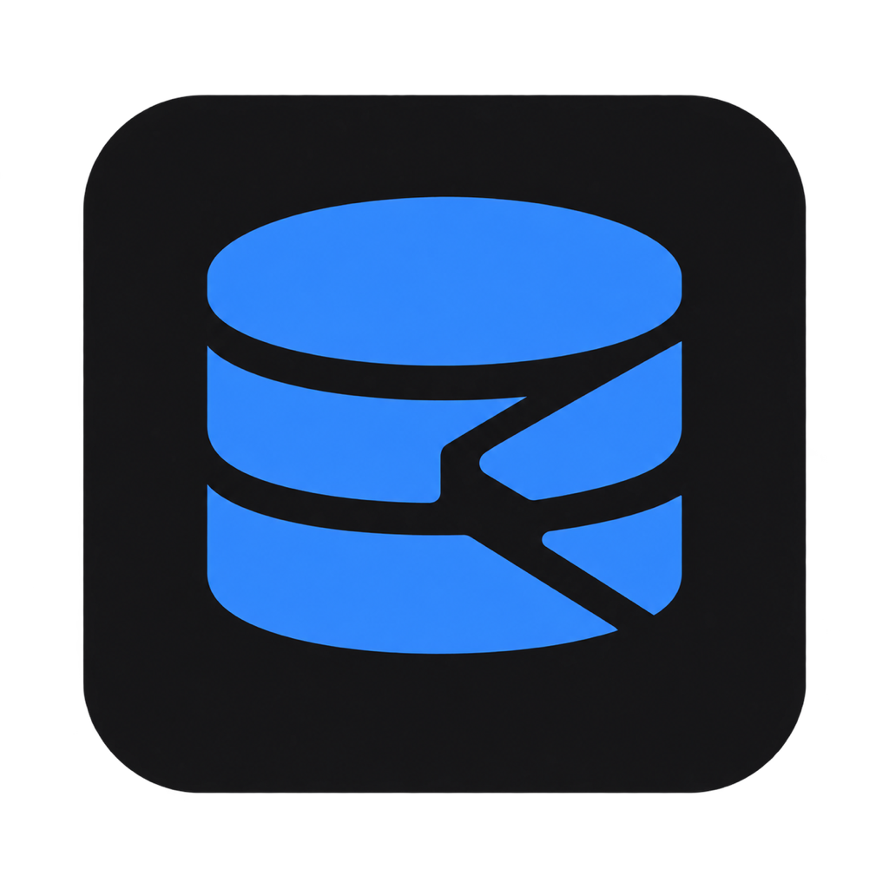
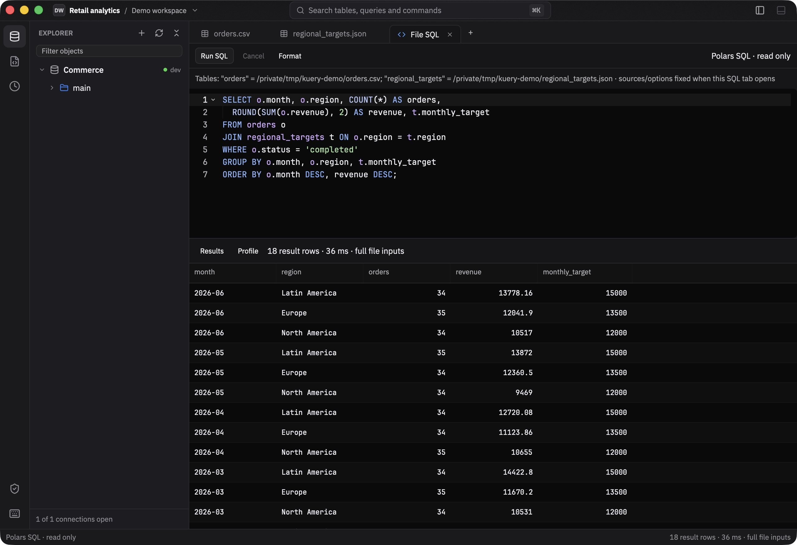
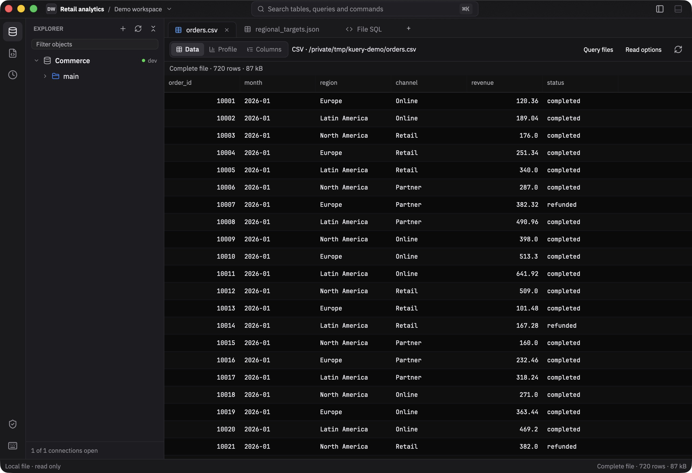
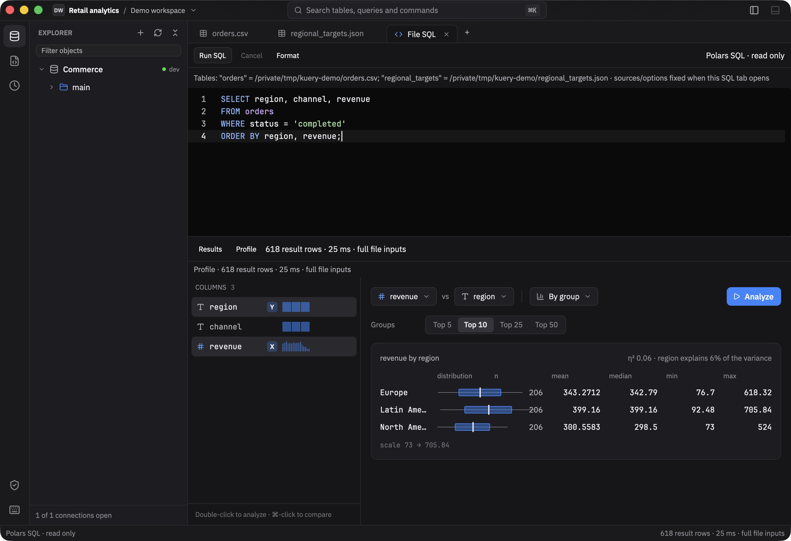
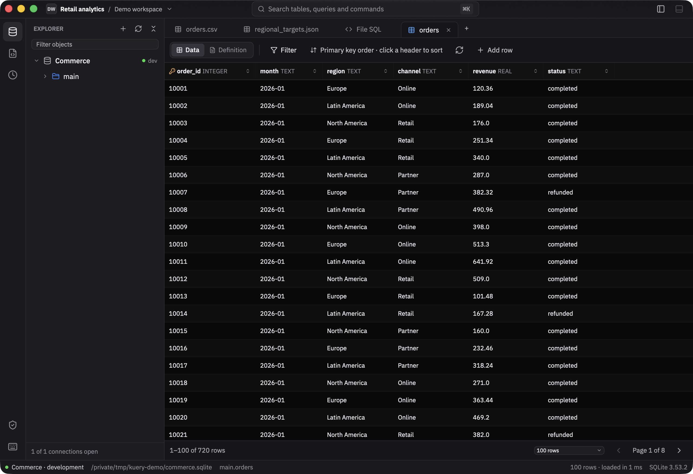

<p align="center">
  
</p>

<h1 align="center">Kuery</h1>

<p align="center">
  <strong>A native workspace for databases, SQL and local data exploration.</strong><br>
  Browse databases. Query files. Understand your results.
</p>

<p align="center">
  <a href="https://binaretech.github.io/kuery/">Website</a> ·
  <a href="#features">Features</a> ·
  <a href="#screenshots">Screenshots</a> ·
  <a href="#getting-started">Getting started</a> ·
  <a href="docs/guide.md">User &amp; development guide</a> ·
  <a href="https://github.com/Binaretech/kuery/releases/latest">Download</a>
</p>

Kuery brings database administration and file analytics into one desktop app.
Work with PostgreSQL, MySQL, MariaDB, SQL Server, SQLite and Redis, or open CSV, JSON and
Parquet files without a database connection. The same results grid and Profile
views help you move from a query to an explanation of the data.

Built in Rust with [GPUI Kit](https://crates.io/crates/gpui-kit),
[Apache Arrow](https://arrow.apache.org/) results and
[Polars](https://pola.rs/) for local file queries. Desktop targets are macOS,
Windows and Linux.

> **Project status:** early prototype under active development. The features
> below describe the current source tree. [Release builds](https://github.com/Binaretech/kuery/releases/latest)
> may lag behind recent changes and update themselves once installed; file SQL
> is currently a temporary, read-only workspace.



## Features

| Area | What you can do |
| --- | --- |
| **SQL workspace** | Open multiple query tabs; use syntax highlighting, table/column completion and formatting; run a selection or the statement under the cursor. Database queries also support scripts, cancellation, timeouts and an output log. |
| **Database explorer** | Browse connections, schemas, tables, views and driver-supported routines, triggers and types. Filter, sort and page table data on the server; inspect columns, keys, indexes and definitions. |
| **Local files** | Open CSV/TSV, JSON arrays, JSONL/NDJSON and Parquet. Inspect native/inferred types, adjust CSV options and distinguish a complete file from a limited preview. |
| **SQL over files** | Use Polars SQL for SELECT, WITH, filters, aggregations, unions and joins across the files registered in a File SQL tab. Queries read complete inputs; the grid limits the displayed output. |
| **Profile & charts** | Explore missing values, distinct values, distributions, percentiles, categories and timelines. Compare groups with box plots, cross tabs, time breakdowns and numeric correlations. Analysis runs when requested. |
| **Query plans** | Explore supported EXPLAIN output as a tree or graph, inspect step details and compare plans. PostgreSQL plans include timing, row-estimate comparisons and insights. |
| **Schema diagrams** | Explore tables and foreign keys with crow's-foot relationships, keys-only views and saved card positions. |
| **Controlled writes** | Start in read-only mode. Use explicit SQL write modes, transaction commit/rollback and impact previews where supported. Table edits are staged and checked before saving. Environment policies govern development, staging and production. |
| **Redis tools** | Browse keys with SCAN, inspect strings/JSON, hashes, lists, sets, sorted sets and streams, and run commands in a dedicated console. Writes use explicit environment-aware controls. |
| **Projects & navigation** | Keep connection definitions, saved SQL and diagram positions in a folder-based project. Use recent projects, the command palette, contextual menus, history and configurable shortcuts. |
| **Connectivity** | Use driver-specific TLS settings and OpenSSH tunnels. Connection passwords are stored in the operating system's credential store rather than the project file. |
| **Result workflows** | Copy cells and rows as text, TSV or JSON. Export database SQL query results to CSV, TSV or JSON. File SQL results currently use the shared grid's copy menus. |
| **Updates** | Release builds check for a newer release at startup and every six hours, download and verify it in the background, and offer to restart into it. The status bar's right corner shows the running version (`Version: 0.3.2`) or the update's progress: `Checking for updates`, `New update available`, `Downloading updates`, then `Restart to update` (click it to restart). Check by hand with **Check for Updates…**; turn the automatic check off with **Toggle Automatic Update Checks**. |

## Screenshots

Current captures use synthetic commerce data. They show the actual UI and
results, with no customer data or credentials.

### Query files with SQL

Join local sources and aggregate complete inputs with Polars. The editor lists
registered table names; the result panel reports the output row count and run
time. The opening image shows this workflow.

### Explore the source data

Read a file in the same virtualized grid used for SQL results. Switch between
Data, Profile and Columns; change read options and reload when needed.



### Understand the result with Profile

Inspect a distribution or compare a measure across groups. Profile works on
the rows held by the current result, so its scope stays visible.



### Browse a database

Local files and database connections share the same project workspace. Browse
a SQLite database alongside your file tabs, with server-side browsing controls
and access to the table definition.



For additional views, see the [query plan](docs/screenshots/plan-tree.png),
[schema-related workflows](docs/guide.md#diagrams),
[write review](docs/screenshots/write-review.png) and
[Redis console](docs/screenshots/redis-console.png).

## Supported sources

| Source | Browsing | Querying | Notes |
| --- | --- | --- | --- |
| **PostgreSQL** | Schemas, tables, views, routines, triggers, enums and definitions | SQL editor, read-only reads, explicit write modes | Streaming results, plan inspection, TLS and SSH. |
| **MySQL / MariaDB** | Databases presented as schemas, tables, views and routines | SQL editor, read-only reads, explicit write modes | DDL that commits implicitly is refused wherever rollback is promised. |
| **SQL Server** | Databases, schemas, tables, views and routines | SQL editor with `GO` batches, read-only reads, explicit write modes | Query plans and server activity. SQL Server logins only; see the guide for the read-only guarantee. |
| **SQLite** | Local database files, tables, views and definitions | SQL editor, query-only reads, explicit write modes | Existing files only; missing paths do not create an empty database. |
| **Redis** | Standalone databases and keys, including streams | Dedicated command console | Read-only by default. Redis writes apply immediately and cannot be rolled back. |
| **CSV / TSV** | File preview, inferred schema and Profile | Polars SQL | Comma, semicolon or tab; header and NULL options. |
| **JSON / JSONL / NDJSON** | Object records, inferred schema and Profile | Polars SQL | JSON is an array of objects; JSONL/NDJSON has one object per nonblank line. |
| **Parquet** | File preview, native schema and Profile | Polars SQL | Preserves native schema metadata; nested and binary values have readable representations. |

Database SQL uses the selected database's dialect. File SQL uses Polars SQL;
SQL features and functions are not interchangeable across engines.

## Getting started

### Install a release

Download the build for your platform from the
[website](https://binaretech.github.io/kuery/#download) or the
[latest release](https://github.com/Binaretech/kuery/releases/latest):

| Platform | File | Install |
| --- | --- | --- |
| **macOS** (Apple Silicon and Intel) | `kuery-<version>-universal-apple-darwin.dmg` | Open the disk image and drag Kuery onto Applications. A `.zip` of the app is also published. |
| **Windows** x64 | `kuery-<version>-x86_64-pc-windows-msvc.zip` | Unzip it and run `kuery.exe`. |
| **Linux** x86_64 (glibc) | `kuery-<version>-x86_64-unknown-linux-gnu.tar.gz` | Extract it and run `./kuery`. |

Each release lists the archives' SHA-256 checksums in `SHA256SUMS`. Once
installed, Kuery updates itself: it only installs archives whose checksum and
minisign signature match the release's `latest.json`. The automatic check can
also be turned off in `settings.toml` in the user config directory:

```toml
[updates]
check_automatically = false
```

If Kuery closes unexpectedly, the next start asks whether to send a crash
report. Nothing is sent unless you choose **Send Report**. The report holds
the error message and where in Kuery's code it happened, with the version and
platform; text in quotes (where error messages put queries and values),
passwords, credentials in connection URLs and your home folder are taken out
first. Choosing **Don't Send** discards it. The
details also stay in `panic.log` in the user config directory, for a bug
report. Builds made from source never send reports.

### Open files and folders from the terminal

```bash
kuery ~/projects/shop             # open a folder as a project
kuery orders.csv events.parquet   # open data files in tabs
kuery --help
```

`kuery [PATH...]` opens each folder as a project and each CSV, TSV, JSON,
JSONL/NDJSON or Parquet file in a read-only tab. A data file goes to the
project the same command opened, else the active project window; with no
project window open it gets a window of its own. When Kuery is already
running, the command hands the paths to it and returns; otherwise it starts
Kuery. A missing path or an unsupported file prints an error and exits with
status 1.

| Platform | Getting `kuery` on your PATH |
| --- | --- |
| **macOS** | Run **Install kuery Command** from the Kuery menu or the command palette. It links `/usr/local/bin/kuery` to the app, asking for an administrator password if that folder needs one. Move Kuery to Applications first. |
| **Windows** | Add the folder holding `kuery.exe` to `PATH`. |
| **Linux** | Put the extracted `kuery` in a folder on `PATH`, such as `~/.local/bin`. |

### Run from source

Install the toolchain pinned in [rust-toolchain.toml](rust-toolchain.toml) and
the native build dependencies for your platform. Then:

```bash
git clone https://github.com/Binaretech/kuery.git
cd kuery
cargo run --locked -p kuery
```

The welcome window lets you open a folder or create a project. To open a
project or data file directly:

```bash
cargo run --locked -p kuery -- /path/to/project
```

A development build hands paths only to another development build, never to
an installed Kuery.

On Linux, the current CI build installs:

```bash
sudo apt-get install pkg-config libfontconfig-dev libfreetype-dev \
  libwayland-dev libxkbcommon-dev libxkbcommon-x11-dev \
  libx11-xcb-dev libxcb1-dev libvulkan-dev
```

macOS builds need Xcode Command Line Tools; Windows builds use the MSVC
toolchain and its C++ build tools. See the
[development guide](docs/guide.md#development) and
[CI configuration](.github/workflows/ci.yml) for the repository's build setup.

When the checkout lives on an external drive, keep build artifacts on an
internal drive by setting `CARGO_TARGET_DIR`. For example, on macOS:

```bash
export CARGO_TARGET_DIR=/private/tmp/kuery-target
cargo run --locked -p kuery
```

### Explore a local file

1. Open a project folder.
2. Choose **File → Open Data File…**, or press **⌘⇧O** on macOS / **Ctrl+Shift+O** elsewhere.
3. Inspect **Data**, **Columns** or **Profile**. Use **Read options** for CSV settings and preview limits.
4. Open other files if you want to join them, then choose **Query files**.
5. Use the table names listed above the SQL editor. Run with **⌘↵** / **Ctrl+Enter**.

For an opened `orders.csv`, for example:

```sql
SELECT region,
       COUNT(*) AS orders,
       ROUND(SUM(revenue), 2) AS revenue
FROM orders
WHERE status = 'completed'
GROUP BY region
ORDER BY revenue DESC;
```

Each File SQL tab captures the successfully opened sources and their applied
read options when created. Open a new SQL tab to include additional files or
changed options. If a file changes on disk, reload its file tab before opening
a new SQL tab.

### Connect to a database

Use **New Connection…** or the explorer's **+** button. Pick a driver, provide
its connection details and use **Test Connection** before saving. SQLite asks
for a file path; network drivers offer their own TLS settings and optional SSH
tunneling. Saved connection definitions belong to the project; passwords go
to the system credential store.

A project is a regular folder with a small `.kuery/` directory:

```text
my-project/
└── .kuery/
    ├── project.toml      # Project and connection definitions; no passwords
    ├── queries/          # Saved database SQL queries
    └── diagrams/         # Diagram positions
```

The sample database stack is optional. The
[development guide](docs/guide.md#development) covers the seeded PostgreSQL,
MySQL, SQL Server, Redis, SQLite and SSH examples.

## Shortcuts

`⌘` on macOS corresponds to `Ctrl` on Windows and Linux for the `secondary`
modifier used by Kuery's keymap.

| Action | macOS | Windows / Linux |
| --- | --- | --- |
| Command palette | ⌘K or ⌘⇧P | Ctrl+K or Ctrl+Shift+P |
| Open project | ⌘O | Ctrl+O |
| Open data file | ⌘⇧O | Ctrl+Shift+O |
| Run statement or selection | ⌘↵ | Ctrl+Enter |
| Insert a newline in the SQL editor | ⌘⇧↵ | Ctrl+Shift+Enter |
| Format SQL | ⌘⇧F | Ctrl+Shift+F |
| Cancel query | ⌘. | Ctrl+. |
| Save a database SQL query | ⌘S | Ctrl+S |
| Close tab | ⌘W | Ctrl+W |
| Toggle sidebar | ⌘B | Ctrl+B |

Shortcuts are configurable in `keymap.toml`. Open it from the command palette
with **Open Keymap File**, then apply edits with **Reload Keymap**.
[Keymap reference →](docs/guide.md#commands-and-shortcuts)

## Scope and current limitations

- **Preview versus query:** file previews default to 10,000 input rows
  (configurable up to 100,000). File SQL queries read complete inputs and
  display up to 10,000 output rows within a 64 MiB text-buffer budget.
- **Memory:** display limits do not cap Polars' working memory. CSV and
  Parquet use lazy scans; JSON and JSONL are fully loaded and validated for
  SQL. CSV float inference receives an additional precision check before SQL.
- **JSON:** regular JSON documents are limited to 32 MiB; JSONL/NDJSON has a
  32 MiB limit per record and, for File SQL, 256 MiB per file. Schema conflicts and unsupported integer ranges
  produce errors rather than silently discarding values.
- **Statistics:** Profile analyzes the current displayed result. Numeric
  statistics use f64; temporal grouping reads timestamp hours as written.
- **File SQL lifecycle:** tabs are temporary and read-only. One statement runs
  at a time; file-path table functions and writes are disabled. Closing a
  source preview does not remove bindings already captured by a SQL tab.
- **Cancellation:** file reads and queries share two worker slots. Cancelling
  discards the result; an active Polars worker may continue until it finishes.
- **Writes:** database capabilities differ. Read the
  [write-mode guide](docs/guide.md#write-mode) before using explicit write modes.
  Redis changes have no rollback.

## Architecture

Kuery keeps UI code, shared result handling and data engines separate. Database
adapters implement a shared session contract; Polars stays behind the file
crate and returns the same result representation consumed by the grid and
Profile.

| Crate | Responsibility |
| --- | --- |
| [`kuery`](crates/app) | Desktop UI, editors, explorer, grids, charts, projects and command routing. |
| [`kuery-core`](crates/core) | Arrow-backed results, SQL analysis, session policies, catalog models, statistics and comparisons. |
| [`kuery-pg`](crates/pg) | PostgreSQL adapter, catalog, TLS, streaming and cancellation. |
| [`kuery-mysql`](crates/mysql) | MySQL/MariaDB adapter and database-specific behavior. |
| [`kuery-mssql`](crates/mssql) | SQL Server adapter and database-specific behavior. |
| [`kuery-sqlite`](crates/sqlite) | SQLite adapter and local database access. |
| [`kuery-redis`](crates/redis) | Redis runtime, key browsing, value handling and console commands. |
| [`kuery-files`](crates/files) | Polars readers, schema metadata, bounded previews and read-only file SQL. |
| [`kuery-update`](crates/update) | Release checks, verified downloads and in-place installs for the in-app updater, with no UI dependencies. |

See the [driver architecture](docs/guide.md#drivers) for adapter responsibilities
and the shared conformance tests.

## Development and contributions

Read [CONTRIBUTING.md](CONTRIBUTING.md) before opening a pull request: first-time
contributors sign the [Contributor License Agreement](CLA.md). Start with the
[user and development guide](docs/guide.md). For a source change,
run the checks appropriate to its scope; the repository's standard checks are:

```bash
cargo fmt --all --check
cargo clippy --workspace --all-targets --locked -- -D warnings
cargo test --workspace --locked
```

Tests marked `ignored` require the development databases or SSH bastion; they
are separate from the default suite. CI is configured for macOS, Windows and
Linux, with additional database integration jobs. The
[release workflow](.github/workflows/release.yml) packages Linux x86_64,
macOS and Windows x86_64 builds for tagged releases. The macOS build is a
single universal app (Apple Silicon and Intel, merged with `lipo`), shipped as
a `.dmg` installer and a `.zip`.

The macOS app and disk image are signed with a Developer ID certificate, notarized and stapled
when these repository secrets are set; without them it gets an ad-hoc signature
and macOS blocks it until it is allowed in System Settings → Privacy & Security
→ Open Anyway:

| Secret | Value |
|---|---|
| `MACOS_CERTIFICATE` | The "Developer ID Application" certificate and its private key exported as `.p12`, base64-encoded (`base64 -i cert.p12`) |
| `MACOS_CERTIFICATE_PASSWORD` | The password chosen when exporting the `.p12` |
| `APPLE_API_KEY` | An App Store Connect API key (`AuthKey_XXXX.p8`, "Developer" access), base64-encoded |
| `APPLE_API_KEY_ID` | That key's ID |
| `APPLE_API_ISSUER_ID` | The issuer ID shown above the keys in App Store Connect → Users and Access → Integrations |

Each release also publishes `latest.json`, which the in-app updater reads from
the latest release, and a minisign signature (`.minisig`) for every archive it
installs. The app only installs archives signed by the key whose public half is
[`crates/app/assets/update.pub`](crates/app/assets/update.pub); the release
workflow checks its signatures against that file. The secret half is the
`UPDATE_SIGNING_KEY` repository secret (the passwordless minisign secret key
file's contents). Keep a backup of it: without it, no update can be signed for
the apps already installed.

Releases are versioned from the commit messages, which follow
[Conventional Commits](https://www.conventionalcommits.org). To release, run
the [Release PR workflow](.github/workflows/release-pr.yml) from `main`
(Actions → Release PR → Run workflow): [release-plz](https://release-plz.dev)
(configured in [`release-plz.toml`](release-plz.toml)) opens a "chore: release
X.Y.Z" pull request, or updates the open one; after a release, wait for its
Release run to tag it first. Since the last `vX.Y.Z` tag, a `feat:` commit
raises the minor version, `fix:` and the rest the patch, and a `!` or
`BREAKING CHANGE` the major (the minor until 1.0); the pull request bumps
`[workspace.package] version` in `Cargo.toml` and `Cargo.lock` and adds the
commits to [`CHANGELOG.md`](CHANGELOG.md).
Merging it makes the [Release workflow](.github/workflows/release.yml) tag
`vX.Y.Z` and publish it; any version merged into `main` that has no tag yet is
released the same way. A `v*` tag pushed by hand must match the `Cargo.toml`
version. Opening the pull request needs "Allow GitHub Actions to create and
approve pull requests" (Settings → Actions → General).

### Website

The [website](https://binaretech.github.io/kuery/) is plain HTML, CSS and
JavaScript in [`site/`](site). The [Pages workflow](.github/workflows/pages.yml)
assembles it with [`build-site.sh`](.github/scripts/build-site.sh), which adds
the screenshots from `docs/screenshots` and the app icon, and fills in the
latest release's version and download links; it refuses to publish links to
files the release does not have. The site deploys on every push to `main` that
touches it, and the release workflow redeploys it after publishing a release.
To preview it locally, build it with a tag and serve the output:

```bash
.github/scripts/build-site.sh /tmp/kuery-site/kuery v0.3.0
python3 -m http.server 8000 --directory /tmp/kuery-site
```

Then open `http://localhost:8000/kuery/`.

### Reporting bugs

Include the platform, build/commit, steps to reproduce and a small synthetic
dataset or query where possible. Remove credentials and private data from
screenshots and sample files.

## License

Copyright (C) 2026 Ángel Afonso, Hector Zurga and the Kuery contributors.

Kuery is free software: you can redistribute it and/or modify it under the
terms of the [GNU General Public License, version 3](LICENSE) (GPL-3.0-only).
It is distributed in the hope that it will be useful, but WITHOUT ANY
WARRANTY; without even the implied warranty of MERCHANTABILITY or FITNESS FOR
A PARTICULAR PURPOSE. See the license for details.

The license applies to every version of Kuery since the first commit,
including source and releases published before this file was added.

## Branding and acknowledgements

The logo above is the same [Kuery application icon](crates/app/assets/branding/kuery.png)
embedded in the desktop app. Platform icon files and its generation record
live in [assets/branding](crates/app/assets/branding).

Kuery bundles **IBM Plex Sans** and **JetBrains Mono** under the SIL Open Font
License 1.1, plus **Lucide** icons under the ISC license. Their notices are
included alongside the [fonts](crates/app/assets/fonts) and
[icons](crates/app/assets/icons/LICENSE-LUCIDE).
